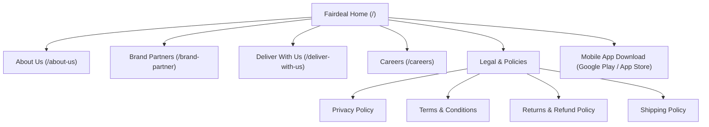

# Fairdeal.market — Comprehensive Website Audit

**Author:** Senior Frontend Engineer & UI/UX Specialist  
**Target:** Fairdeal Engineering Team Redesign Proposal  
**Audit Date:** October 2026  
**Audited Domain:** [https://www.fairdeal.market/](https://www.fairdeal.market/)  
**Document Location:** `docs/website-audit.md`

---

## 1. Executive Summary & Objective

Fairdeal (`FDMS Marketplace Pvt. Ltd.`) is India's fastest-growing B2B wholesale quick-commerce platform built specifically for India's 13 million Kirana and local convenience store owners. It promises wholesale FMCG procurement delivered in under 60 minutes across categories including staples, beverages, namkeen, biscuits, personal care, and household items.

This audit evaluates the public-facing web presence across desktop and mobile devices. The goal is to provide an objective, evidence-based assessment of the current website’s content structure, navigation, usability, accessibility (WCAG 2.2 AA), and frontend performance. It sets the foundation for a modern, high-converting, accessible, and performant redesign proposal.

---

## 2. Pages Inspected & Accessibility Log

| Page URL | Status | Inspected Sections & Workflows | Notes / Access Limitations |
| :--- | :--- | :--- | :--- |
| `https://www.fairdeal.market/` | **Accessible (200 OK)** | Hero, Retailer KPIs, USP Cards, Brand Carousel, Category Browser, Deliver With Us teaser, Retailer Testimonials, Investor logos, Footer. | Public homepage. In-browser client state rendered "0+" counters before hydration. |
| `https://fairdeal.market/about-us/` | **Accessible (200 OK)** | Mosaic photo gallery, Mission & Vision statements, FAIR core values, Leadership team (CEO, CIO, VP Tech, Aishwarya Rana), Footer. | Rich factual context on founders and company values. |
| `https://fairdeal.market/brand-partner/` | **Accessible (200 OK)** | FMCG Brand partner hero, Retailer reach stats, Supply chain benefits, Real-time analytics USP, FAQs. | The interactive Partner Lead Capture form bailed out to client-side hydration (`BAILOUT_TO_CLIENT_SIDE_RENDERING`), making it non-functional in static SSR. |
| `https://fairdeal.market/deliver-with-us/` | **Accessible (200 OK)** | Partner onboarding hero, Earnings banner (₹60k/mo), 3-step warehouse process, Incentives breakdown, Vehicle types (Bike, Auto, EV Loader), Warehouse map, FAQs. | Strong operational copy. Map iframe creates third-party render-blocking and layout shifts. |
| `https://fairdeal.market/careers/` | **Accessible (200 OK)** | Team hero mosaic, Culture statement, Job search input, Department dropdown, Open role listing cards. | Job openings table relies on client-side fetch that showed "Loading roles…" in SSR HTML. |
| `https://fairdeal.market/privacy-policy/` | **Accessible (200 OK)** | Legal policy links in footer. | Referenced for legal transparency and footer navigation. |
| `https://fairdeal.market/terms-and-conditions/` | **Accessible (200 OK)** | Terms of service. | Referenced for footer compliance. |
| `https://fairdeal.market/returns-and-refunds-policy/` | **Accessible (200 OK)** | Returns & refunds guidance. | Referenced for footer compliance. |
| `https://fairdeal.market/shipping-and-delivery-policy/` | **Accessible (200 OK)** | 60-minute delivery policy. | Referenced for SLA transparency. |

---

## 3. Existing Page Hierarchy & Navigation Architecture

### Navigation Observations:
1. **Header Consistency:** Both desktop and mobile headers feature a fixed 56px–68px bar with links: "About Us", "Careers", "Sell With Fairdeal", "Deliver With Us", and a prominent "Download App" button.
2. **Missing B2B Exploration Flow:** Although the primary audience is retail Kirana store owners looking to buy inventory, the current public site has no interactive product catalog or search preview on the web. It forces an immediate mobile app download without letting retailers explore current wholesale pricing, SKU varieties, or margin margins.
3. **Redundant Code Paths:** The current website duplicates full desktop and mobile JSX trees via `block lg:hidden` and `hidden lg:block` across every single section, multiplying DOM node count and inflating the initial JavaScript/HTML payload.

---

## 4. Primary User Personas & Goals

### Persona A: Kirana & Retail Store Owner (Ramesh, 42, Gurugram)
* **Goal:** Wants to restock high-moving FMCG items (Parle, Bisleri, Sting, Haldiram's, Oil) quickly without locking up ₹30,000–₹50,000 in working capital or leaving the shop to visit wholesale mandis.
* **Pain Point:** Stockouts during peak afternoon/evening demand; lack of transparent wholesale price comparisons; slow next-day delivery by traditional distributors.
* **Website Requirement:** Wants proof of speed (60-minute SLA), SKU variety (1,000+ items), credible testimonials from fellow shop owners, and a clear, seamless route to start ordering.

### Persona B: FMCG Brand Partner / Manufacturer (Pooja, 35, National Sales Head)
* **Goal:** Wants direct distribution into 20,000+ local retail outlets without dealing with multiple intermediaries, credit leakage, or opaque regional stockists.
* **Pain Point:** Lack of real-time sell-through data and delays in retailer reach for newly launched SKUs.
* **Website Requirement:** Fast onboarding flow, transparent logistics explanation, proof of brand partnerships (Coca-Cola, Parle, Mentos, Uncle Chipps), and an inquiry form with validation.

### Persona C: Delivery Rider / Fleet Vendor (Sunil, 26, Delhi-NCR)
* **Goal:** Looking for consistent daily/weekly income delivering wholesale orders with a two-wheeler, three-wheeler, or EV loader.
* **Pain Point:** Uncertainty in delivery payouts, hidden cuts, or lack of support.
* **Website Requirement:** Clear earnings potential (up to ₹60,000/month), transparent incentive structures (₹3,000 joining bonus, weekly payouts), exact warehouse location, and direct onboarding contact.

### Persona D: Prospective Team Member / Tech Talent (Vikram, 28, Senior Software Engineer)
* **Goal:** Wants to understand company culture, leadership pedigree, funding status, and open engineering/operations roles.
* **Website Requirement:** Seamless search and filter by department, clear job descriptions, and direct application routes.

---

## 5. Existing Content & CTA Destinations

* **Primary CTAs:**
  * "Download App" -> Links to Google Play (`fairdeal.market.fairsight`) and Apple App Store (`id6504799859`).
  * "Sell With Fairdeal" -> `/brand-partner/` inquiry form.
  * "Deliver With Us" -> `/deliver-with-us/` (direct warehouse visit + fleet phone `7428614455`).
  * "Join Team" -> `/careers/` (email application to `careers@fairdeal.market`).
* **Content Accuracy Check:**
  * Verified Founders: Prateek Bansal (Founder & CEO), Yash Bansal (Co-Founder & CIO), Ravi Chaurasia (VP - Technology).
  * Backed by: WaterBridge Ventures, Incubate Fund, Shiprocket, Alteria Capital, British International Investment (BII).
  * Operational HQ: FDMS Marketplace Pvt. Ltd., Landmark Cyber Park, Sector 67, Gurugram, Haryana 122101.

---

## 6. Usability & UX Observations

### Desktop Usability
1. **Double DOM Duplication:** In order to cater to different screen sizes, the current implementation renders duplicate markup blocks (`
...
` alongside `
...
`). This increases hydration time and causes layout engine overhead.
2. **Carousel & Animation Fragility:** CSS keyframe animations for marquee brand scrollers are hardcoded with fixed widths. On wide monitors (1440px+), seams or jumpy loop resets are noticeable.
3. **Non-Interactive Testimonial Cards:** The desktop testimonial section features a horizontal accordion that lacks accessible keyboard controls (`tabIndex`, `aria-expanded`).
4. **Lack of In-Browser Catalog Preview:** B2B retailers visiting the website on desktop or tablet cannot inspect categories or verify product pricing without installing an APK/app.

### Mobile Usability
1. **Hamburger Menu Issues:** In the audited DOM, the mobile menu button opens a basic sheet without focus trapping, escape key listeners, or ARIA attributes.
2. **Horizontal Overflow in Value Cards:** The FAIR values section on small viewports (320px–360px) experiences horizontal scroll jitter.
3. **Small Touch Targets:** Several footer and inline links have touch areas under the WCAG recommended 44x44px minimum target size.

---

## 7. Observed Accessibility (a11y) Issues (WCAG 2.2 AA)

1. **Non-Semantic Interactive Elements:** Certain buttons are styled `div` or `a` tags without `role="button"` or proper `href` attributes.
2. **Missing Accessible Names:** Icon-only buttons (such as carousel arrows and social links) lack `aria-label` descriptors.
3. **Color Contrast:** Muted text elements using `#6F6F6F` on light blue `#EEF3FB` or `#F3F8FF` backgrounds fall below the 4.5:1 contrast ratio required for normal body text.
4. **No Reduced-Motion Safeguards:** Continuous CSS marquee animations (`marqueeMobileFwd`, `animate-marquee-brand-1`) do not respect `@media (prefers-reduced-motion: reduce)`.
5. **Form Error Association:** Form controls on the brand partner page lack `aria-describedby` links to dynamic error messages.

---

## 8. Performance Bottlenecks & Audit Data

1. **Massive Font & CDN Preloads:** The current site preloads multiple font weights from Fontshare Satoshi (`satoshi@900,700,500,301,701,300,501,401,901,400,2`), external Swiper CSS, and Swiper JS scripts via external CDNs, delaying the critical rendering path.
2. **Unoptimized Layout Shifts (CLS):** Hero counters initialized to `"0+"` and `"0 Min"` in SSR HTML trigger layout shifts upon client-side counter animation.
3. **Uncached Asset Payloads:** Static WebP and SVG images lack width/height attributes in various sections, resulting in reflow during image decode.
4. **Unused JS Chunks:** Multiple Next.js vendor chunks (Turbopack development remnants) are loaded sequentially.

---

## 9. Proposed Redesign Improvements & Priority Matrix

| Priority | Area | Proposed Improvement | Justification / Impact |
| :--- | :--- | :--- | :--- |
| **P0 (Critical)** | **Catalog Preview** | Add an interactive "Retailer Experience Demo" with product search, category filters, quantity selectors, live margin calculator, and demo cart. | Drastically increases Kirana owner conversion by letting them experience Fairdeal's inventory and margins before installing the app. |
| **P0 (Critical)** | **Single Clean DOM** | Eliminate double DOM duplication with responsive Tailwind CSS utilities. | Halves DOM node count, optimizes memory usage, and speeds up layout calculations. |
| **P1 (High)** | **Architecture & State** | 4-Layer Architecture (`Domain`, `Infrastructure`, `Application`, `Presentation`) with Redux Toolkit for shared prototype state. | Ensures enterprise maintainability, separation of concerns, testability, and typed state management. |
| **P1 (High)** | **Accessible UI Primitives** | Implement shadcn/ui accessible components (Sheet, Dialog, Accordion, Select, Tabs, Toast). | Resolves WCAG 2.2 AA issues; provides accessible modal/drawer navigation and keyboard focus traps. |
| **P1 (High)** | **Performance & Motion** | Clean GSAP + ScrollTrigger animations with `prefers-reduced-motion` fallbacks, Vite bundling, route code splitting. | Produces smooth 60fps micro-interactions without performance regressions or scroll hijacking. |
| **P2 (Medium)** | **Interactive Lead Forms** | Add validated Brand Partner inquiry form and Delivery Partner eligibility calculator. | Provides immediate feedback to prospective partners with zero mock data leakage to third parties. |
| **P2 (Medium)** | **Careers Interactive Search** | Live searchable, filterable job listings by department with modal detail views. | Enables seamless candidate discovery for engineering and operations roles. |

---

## 10. Known Limitations & Assumptions

1. **Independent Redesign Proposal:** This is an independent prototype to demonstrate frontend engineering excellence; it does not replace or modify Fairdeal's live production infrastructure.
2. **Mock Transactions:** All product inventory, cart totals, and partner form submissions operate locally via Redux and client-side mock repositories. No live payment gateways, SMS OTPs, or backend mutations are executed.
3. **Content Sourcing:** All company details, leadership information, and brand logos are sourced exclusively from publicly accessible Fairdeal web pages as documented above.
